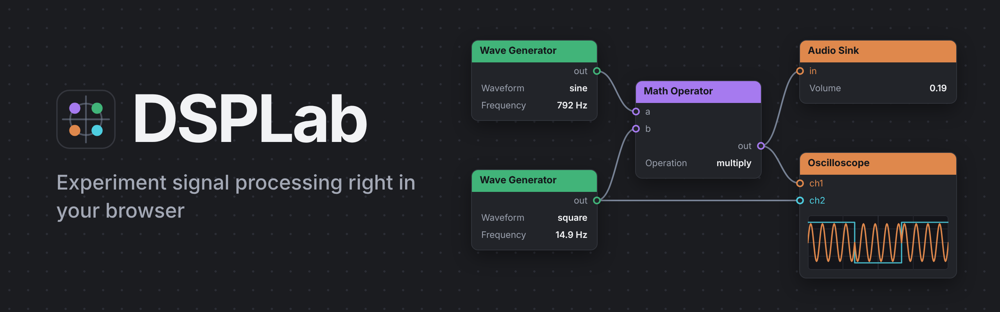

<p align="center"></p>

Works on desktop and on mobile: on a phone the side panels become drawers (see [On a phone](#on-a-phone)).

Build audio signal chains by wiring blocks together on a canvas, then hear them and watch them on an
oscilloscope. It is a small node-based flowgraph editor (think GNU Radio, for the browser) that runs
**entirely in your browser**: no server, no account, nothing to install except a way to serve a few files.

## Quick start

You need Python 3 (only to serve the files) and a modern browser. DSPLab is developed and tested in
Chromium-based browsers (Chrome, Edge, Chromium); others are untested.

```
./serve.sh
```

Open <http://localhost:8000>. (Another port: `./serve.sh 9000`.)

> Double-clicking `index.html` won't work: browsers refuse to load JavaScript modules from `file://`.
> Always go through `serve.sh`.

You start with a **Wave Generator** already connected to an **Audio Sink**. Press **▶ Run** and you hear a
440 Hz tone. Press **■ Stop** to end it.

> Start with a low system volume. A full-scale square wave at a high frequency is harsh.

## The screen

```
┌───────────────────────────────────────────────────────────────────┐
│ DSPLab   [▶ Run]  [Delete selected]                     Stopped   │
├────────────┬──────────────────────────────────────┬───────────────┤
│ PROPERTIES │                                      │ SOURCE BLOCKS │
│            │            canvas                    │ PROCESSING    │
│ settings   │   blocks and the cables between      │ SINK BLOCKS   │
│ of the     │   them                               │               │
│ selected   │                                      │ (drag or      │
│ block      │                                      │  double-click)│
└────────────┴──────────────────────────────────────┴───────────────┘
```

- **Canvas** (centre): your diagram.
- **Block palette** (right): the available blocks, grouped by category.
- **Properties** (left): every setting of the selected block. Blocks themselves only show their key
  values, read-only; you change them here.
- **Toolbar** (top): Run/Stop, delete, the **Examples** menu, and the audio status (the sample rate while
  running).
- **Examples** (toolbar): *Simple tone* (the starting diagram), *ASK modulation* and *Audio source scope* (microphone → oscilloscope). Picking one replaces
  the current diagram, so it asks for confirmation first (unless the canvas is empty); it can't be undone,
  because the autosave overwrites the old diagram.

### On a phone

On narrow screens (or a phone held sideways) the canvas fills the screen. **Properties** are always
shown in a panel below the canvas, and the **Blocks** palette is a drawer that slides up from the
bottom: open it with the **Blocks** button in the toolbar; tapping the empty canvas closes it. **Tap** a
block in the palette to add it, since drag and drop and double-click don't work well on touch screens.
Everything else (moving blocks, connecting ports, panning) works with your finger as it does with the
mouse, and pinching the canvas zooms.

## Working with blocks

| To… | Do this |
|---|---|
| Add a block | Drag it from the palette onto the canvas, or double-click it in the palette |
| Move a block | Drag it by any part of the block (title bar or body) |
| Connect blocks | Drag from an **output** port (right side of a block) to an **input** port (left side of another) |
| Select a block or a cable | Click it. Its settings (or, for a cable, where it goes from and to) appear in Properties |
| Edit a setting | Select the block, then use the controls in Properties |
| Set an exact value | Type it in the number field under a slider and press Enter (or leave the field). Values outside the range are clamped to it |
| Delete the selection | `Delete` or `Backspace`, or the **Delete selected** button (just **Delete** on a phone) |
| Pan the canvas | Drag the empty background |
| Zoom the canvas | Pinch with two fingers (a two-finger drag also pans), or scroll the mouse wheel over the canvas. 30 %–250 %; the zoom is saved with the diagram |
| Deselect | Click the empty background |

Connection rules:

- A cable always goes from an output to an input, and never from a block to itself.
- An **input takes one cable**: connecting a second one replaces the first.
- An **output can feed many inputs**.
- An unconnected input counts as silence (zero).

You can change settings while the audio is running and hear the result immediately. Adding or removing
blocks and cables while running also works, but rebuilds the audio graph, so expect a brief click and
the oscillators restarting their phase.

## Blocks

### Source blocks

**Wave Generator**: a tone generator. Output: `out`.

| Setting | Range | Default |
|---|---|---|
| Waveform | sine, square, sawtooth, triangle | sine |
| Frequency | 1 Hz – 20 000 Hz (logarithmic slider) | 440 Hz |
| Amplitude | 0 – 1 | 0.5 |
| Offset | −1 – 1 | 0 |

Offset adds a constant (DC) level to the wave, so the output swings around that level instead of around
0. It is independent of Amplitude: amplitude 0.5 with offset 0.3 goes from −0.2 to 0.8.

Shown on the block: Waveform, Frequency and Offset.

**Audio Source**: your microphone (or the browser's default audio input). Output: `out`.

| Setting | Range | Default |
|---|---|---|
| Gain | 0 – 2 | 1 |

The browser asks for microphone permission when you press **Run** with an Audio Source in the diagram
(never otherwise). Echo cancellation, noise suppression and automatic gain are turned off so you get the
raw signal. Wear headphones when sending it to an Audio Sink, or it will feed back. An Audio Source
added while running stays silent until you press Stop and Run again.

Shown on the block: Gain.

**Audio Recorder**: records a sample from your microphone and plays it in a loop. Output: `out`.

| Setting | What it does | Range | Default |
|---|---|---|---|
| Pause | Silence between the end of one play and the start of the next | 0 – 10 s | 1 s |
| Gain | Output level | 0 – 2 | 1 |

Select the block and **hold down** the *Hold to record* button in the properties panel: it records for as long
as you hold it (the Space or Enter key works too), up to 10 s, and stops by itself after that. A hold shorter
than a fifth of a second is ignored and keeps the previous sample; recording again replaces it. The browser
asks for microphone permission the first time. It works whether or not the audio is
running; if it is, the new sample starts looping at once. The node shows the recorded waveform. The sample is
kept in memory only: it is not saved with the diagram, so after a reload you have to record again. Changing
*Pause* restarts the loop. Wear headphones if the loop goes to an Audio Sink.

Shown on the block: Pause.

### Processing blocks

**Math Operator**: combines two signals sample by sample. Inputs: `a`, `b`. Output: `out`.

| Operation | Result |
|---|---|
| add | a + b |
| subtract | a − b |
| multiply | a × b |

An unconnected input is 0, so `add` with only `a` connected passes `a` through, `multiply` with `b`
open gives silence, and `subtract` with only `b` connected inverts it.

**Filter**: a low-pass or high-pass filter (second order, 12 dB per octave). Input: `in`. Output: `out`.

| Setting | Range | Default |
|---|---|---|
| Type | lowpass, highpass | lowpass |
| Cutoff | 10 – 20000 Hz | 1000 Hz |
| Q | 0.1 – 20 | 0.707 |

Low-pass keeps what is below the cutoff and attenuates what is above; high-pass does the opposite. At
the cutoff the level is −3 dB (with Q = 0.707). Raising Q adds a resonant peak at the cutoff.

Shown on the block: Type and Cutoff.

**Pulse Shaper**: turns a stream of 1 × 1 messages (symbols) into a waveform you can play or look at.
Input: `msg`. Output: `out` (audio).

A one is `1` (times the amplitude) and a zero is `0`; the train of symbols is convolved with a pulse shape,
sampled at the audio sample rate. Symbols are placed one after the other on a grid of 1 / baud seconds,
whatever the exact moment each message arrives; the first symbol after a pause starts about 50 ms ahead. Set
the same baud rate here as on the Message Serializer, or the stream will fall behind or run ahead. Messages
that aren't 1 × 1 are ignored.

| Setting | What it does | Range | Default |
|---|---|---|---|
| Pulse | *square* holds the level for the whole symbol; *sinc* is a band-limited pulse that crosses zero at the other symbols' centres | square, sinc | square |
| Baud rate | Symbols per second | 50 – 20000 (logarithmic) | 1000 baud |
| Amplitude | Level of a one | 0 – 1 | 0.5 |

The sinc pulse is cut off 4 symbols to each side of its peak. Changing a setting applies to the next symbol.

Shown on the block: Pulse and Baud rate.

**Symbol Timing Recovery**: samples a digital-looking signal (like the output of a matched filter) at the
right instants and returns the bits. Input: `in` (audio). Output: `msg`.

It runs a simple phase-locked loop: an oscillator that ticks once per symbol (at the baud rate you set) looks
at the signal at the symbol instant and halfway between symbols. A Gardner detector compares the two at every
transition and nudges the oscillator's phase, and slowly its frequency, until the ticks fall on the
symbols' centres. Each tick sends a **1 × 1** message: 1 if the sample is above the decision level, which is
halfway between the levels the loop sees at symbol instants, 0 otherwise.

| Setting | What it does | Range | Default |
|---|---|---|---|
| Baud rate | Nominal symbol rate, the loop's starting frequency | 50 – 20000 (logarithmic) | 1000 baud |
| Loop bandwidth | How fast the loop reacts, as a fraction of the baud rate: higher locks sooner but is noisier | 0.001 – 0.1 (logarithmic) | 0.005 |
| Squelch | Peak-to-peak swing below which the signal counts as silence and nothing is sent | 0 – 1 | 0.1 |

Limits: it needs transitions to lock, so a long run of identical bits is held by the loop's memory rather than
tracked. It cannot tell a silence from zeros in a signal that rests at 0, so a few zeros follow the end of a
unipolar burst until the level estimate fades below the squelch. The ticks are placed by linear interpolation,
which is fine from about 4 samples per symbol up. A pure sinc pulse has long tails that make the detector noisy,
so use a low loop bandwidth with it. Starting from a symbol boundary it may take a while to leave; square
pulses lock quickly.

Shown on the block: Baud rate.

### Sink blocks

**Audio Sink**: plays a signal on your speakers. Input: `in`. Setting: **Volume** 0 – 1 (default 0.8).

Audio is clipped at ±1 by the browser, and nothing in DSPLab prevents that. If you add signals or
turn amplitudes up so the sum exceeds 1, you'll hear distortion; lower the amplitudes. A Wave
Generator's Offset counts too: amplitude 0.5 with offset 0.8 already goes past 1.

**Oscilloscope**: draws signals over time. Inputs: `ch1` … `chN`, each channel in its own colour. It
only draws while the audio is running (otherwise it reads *Stopped*).

| Setting | What it does | Range | Default |
|---|---|---|---|
| Inputs | How many channels (inputs) the block has | 1 – 8 | 2 |
| Trigger | Which channel starts each sweep | `ch1` … `chN` | ch1 |
| Trig level | Level the trigger channel must cross going upwards | −1 – 1 | 0 |
| X / div | Time per horizontal division (10 divisions, so the screen shows ten times this) | 0.1 ms – 100 ms (logarithmic) | 1 ms |
| Y / div | Signal units per vertical division (8 divisions), shared by all channels | 0.01 – 2 (logarithmic) | 0.25 |

Shown on the block: Trigger, X / div and Y / div. The screen has 10 × 8 divisions.
While you change *Trig level* a dashed line shows it on the screen for a moment.

- **Trigger.** Each sweep starts where the trigger channel rises through *Trig level*, and every
  channel is drawn from that same instant, so a repeating signal holds still and channels can be
  compared. The trigger channel can be any of them, which lets you synchronise to a clean reference
  while looking at a messy signal.
- If the trigger channel has no cable, or never crosses the level, the newest samples are drawn
  without synchronisation.
- Channels without a cable aren't drawn.
- If you reduce *Inputs*, cables on the channels that disappear are removed, and the trigger returns to
  `ch1` if its channel is gone.
- At long time scales (X / div of tens of ms) a fast signal fills the screen as a solid band (440 cycles in 1 s can't be told
  apart in 220 pixels). Use a slow signal, or a shorter span, to see the shape. The band's outline is
  the signal's envelope, which is useful on its own (see *Beats* below).

**FFT Plot**: shows the spectrum (level in dB against frequency) of a signal, live. Input: `in`. It only
draws while the audio is running.

| Setting | What it does | Range | Default |
|---|---|---|---|
| Window size | Samples analysed at once. Bigger = finer frequency resolution (bin width = sample rate / size) but slower to react | 256 – 32768 | 2048 |
| Freq. axis | Frequency axis from 0 to half the sample rate, linear or logarithmic (20 Hz up) | linear, log | linear |

The vertical axis goes from 0 dB (full scale) down to −100 dB. The loudest frequency is printed in the corner
as *peak … Hz*. Shown on the block: Window size and Freq. axis.

### Message blocks

Messages are discrete events rather than a continuous signal. Their ports are **square**, and they
travel on their own cables: a message port can only be connected to another message port, never to an
audio one.

A message is a table of ones and zeros with some rows and some columns. Text travels as **8 × N**: one
column per byte (UTF-8, so `é` takes two columns), with the most significant bit in the top row. For
example `A` (0x41) is the single column `0 1 0 0 0 0 0 1`, read from top to bottom. A block never edits
a message it receives; it builds a new one.

**Message Strobe**: sends the same text, as an 8 × N message, again and again. Output: `msg`.

| Setting | What it does | Range | Default |
|---|---|---|---|
| Period | Time between messages | 10 ms – 10 s (logarithmic) | 1000 ms |
| Message | The text sent | up to 100 characters | hello |

It only sends while the audio is running, and sends nothing while the text is empty. Editing the
message applies at once, without restarting the clock.

**Message Debug**: prints the messages it receives, one per line, each with the time (in seconds of
audio) at which it arrived. Input: `msg`. It reads *Stopped* while the audio is off, and the log starts
empty on every Run.

| Setting | What it does | Range | Default |
|---|---|---|---|
| Lines | How many of the newest messages stay on the block | 4, 8, 16 | 8 |
| Decode | Turn an 8 × N message back into text | on, off | on |

A message of any other shape, or any message when *Decode* is off, is printed as its bits: the size,
then the rows separated by `/`, like `2x3  101 / 011`. Control characters in decoded text are shown as `·`.

**Message Reshape**: changes the rows and columns of a message without changing its bits, like
`numpy.reshape`. The bits are read row by row and laid out again in the new shape, so a 1 × 100 message can
become 10 × 10 and back. Input: `msg`. Output: `msg`.

| Setting | What it does | Range | Default |
|---|---|---|---|
| Rows | Rows of the output, or −1 to work it out from Columns | −1, 1 – 4096 | 1 |
| Columns | Columns of the output, or −1 to work it out from Rows | −1, 1 – 4096 | −1 |

Messages have at most two dimensions. The defaults flatten any message into a single row. Rows × columns
must equal the number of bits, and only one of them can be −1. If it doesn't fit, the message is **dropped**
(numpy would raise an error) and the block shows what it could not do, like `3x3 can't be 2 x -1`. The
block also shows the last change, like `8x5 → 2x20`.

**Message Serializer**: turns a message into a stream of single bits. Input: `msg`. Output: `msg`.

Each bit of the incoming message goes out as its own **1 × 1** message, one per symbol, at the baud rate. The
bits are read column by column, so an 8 × N message goes byte by byte, most significant bit first. Pacing
follows the audio clock, so the average rate is exact; because a browser timer can't fire once per symbol at
kilobaud, the symbols that are due are sent together every ~10 ms, and whoever receives them (the Pulse
Shaper) does its own timing. A message that arrives while another is going out is queued behind it.

| Setting | What it does | Range | Default |
|---|---|---|---|
| Baud rate | Symbols per second | 50 – 20000 (logarithmic) | 1000 baud |

Shown on the block: Baud rate.

**Message Deserializer**: collects single bits back into messages, the inverse of the Message Serializer.
Input: `msg`. Output: `msg`.

Every 1 × 1 message adds a bit; when there are *Rows* × *Columns* of them the block sends one message of that
size, filled column by column. With the defaults (8 × 1) every 8 bits make one byte, most significant bit
first, which Message Debug prints as a character.

| Setting | What it does | Range | Default |
|---|---|---|---|
| Rows | Rows of the output message | 1 – 64 | 8 |
| Columns | Columns of the output message | 1 – 4096 | 1 |

Messages that aren't 1 × 1 are ignored. Changing the size drops the bits collected so far, and so does
pressing Run. The block does not look for where a byte starts: it counts bits from the first one it receives,
so after a Symbol Timing Recovery (which can output a few stray bits before and after a burst) the bytes may
be shifted and the text read as garbage. The block shows how many bits it has collected, or the size it last sent.

Shown on the block: Rows and Columns.

## Recipes

**Hear a tone.** Wave Generator → Audio Sink (this is the starting diagram). Press Run and move the
Frequency slider.

**See a wave.** Add an Oscilloscope and connect the generator's `out` to `ch1` as well (an output can feed
several inputs). Press Run. The default 10 ms span shows about four cycles of 440 Hz.

**Amplitude-shift keying.** Pick *ASK modulation* in the Examples menu: a 440 Hz sine is multiplied by a
2 Hz square wave that swings between 0 and 1, so the tone switches on and off. The scope shows the keyed
signal (`ch1`) against the square wave (`ch2`, the trigger).

**Compare two waves.** Add a second Wave Generator and connect it to `ch2`. Set the scope's X / div to
0.5 ms, both generators to 1000 Hz, one to *sine* and the other to *square*, and set *Trigger* to `ch2`:
both traces start where the square wave rises, and you see how the sine lines up with it.

**Beats.** Two generators at 440 Hz and 444 Hz, both into a Math Operator set to *add*, whose output goes
to an Audio Sink and to an Oscilloscope with X / div set to 100 ms. You hear the tone swell four times a
second, and the scope's band shows four lobes.

**Ring modulation.** Same wiring, but set the second generator to 5 Hz and the Math Operator to
*multiply*. The slow wave shapes the 440 Hz tone, which goes silent at every zero crossing of the
slow wave. The result peaks at 0.25 with both amplitudes at 0.5.

**Invert a signal.** Math Operator set to *subtract*, with only `b` connected: the output is `−b`. Feeding
the original on `ch1` and the inverted copy on `ch2` of a scope shows two mirrored traces.

## Saving your work

The diagram is saved automatically in your browser (its `localStorage`) every time you change it, and
is restored when you reload the page. You'll find it exactly as you left it: blocks, positions,
settings, cables and the position of the canvas. Audio doesn't restart by itself, because browsers
require a click to start sound: press Run.

Things to know:

- The saved diagram belongs to **one browser and one address**. `localhost:8000` and `localhost:9000` are
  different places, and so are two browsers.
- Clearing the site's data erases it. There is no file export or import yet.
- To start over, delete all the blocks (an empty diagram is remembered too). There is no "new diagram"
  button yet, so the starting Wave Generator → Audio Sink diagram only comes back in a browser profile
  or address that has never saved one (for example a private window). Removing the saved entry by hand
  isn't enough: the page saves again when it unloads.
- If the browser blocks storage (for example in some private windows), DSPLab still works, it just
  can't remember your diagram.

## Troubleshooting

| Symptom | Likely cause |
|---|---|
| Blank page or no blocks | You opened `index.html` directly. Use `./serve.sh` |
| No sound | Did you press **Run**? Is the Wave Generator connected to an Audio Sink? Check Amplitude, Volume, your system volume and that the tab isn't muted |
| Scope says *Stopped* | Press Run; it only draws while the audio is running |
| Scope draws a flat line | The channel has no cable, or the signal is silent (e.g. a Math Operator with an input open) |
| Trace jitters | The trigger channel has no cable or never crosses *Trig level*, so the sweep is not synchronised |
| Distorted sound | The signal exceeds ±1: lower the amplitudes |
| "Audio error" in the toolbar | The browser couldn't start audio; reload and press Run again |

## Not supported yet

Undo/redo, copy and paste, selecting several blocks at once, zooming the canvas, exporting or importing
diagrams as files, a divide operation, and audio inputs from a microphone or file. Blocks are a short
list for now (one generator, one operator, two sinks, four message blocks).

## For developers

`npm install && npm test` runs the browser test suite. Architecture, conventions and how to add a block
are in [`CLAUDE.md`](CLAUDE.md).
