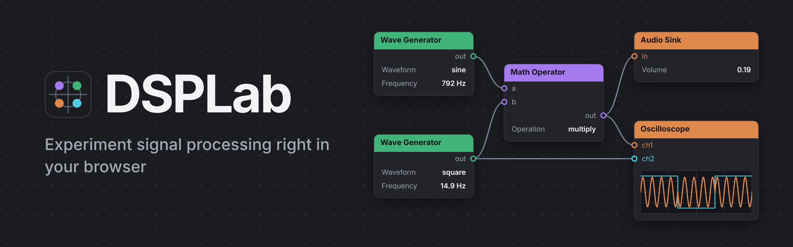

<p align="center"></p>

Works on desktop and on mobile: on a phone the side panels become drawers (see [On a phone](#on-a-phone)).

Build audio signal chains by wiring blocks together on a canvas, then hear them and watch them on an
oscilloscope. It is a small node-based flowgraph editor (think GNU Radio, for the browser) that runs
**entirely in your browser**: no server, no account, nothing to install except a way to serve a few files.

## Quick start

You need Python 3 (only to serve the files) and a modern browser. DSPLab is developed and tested in
Chromium-based browsers (Chrome, Edge, Chromium); others are untested.

```
./serve.sh
```

Open <http://localhost:8000>. (Another port: `./serve.sh 9000`.)

> Double-clicking `index.html` won't work: browsers refuse to load JavaScript modules from `file://`.
> Always go through `serve.sh`.

You start with a **Wave Generator** already connected to an **Audio Sink**. Press **▶ Run** and you hear a
440 Hz tone. Press **■ Stop** to end it.

> Start with a low system volume. A full-scale square wave at a high frequency is harsh.

## The screen

```
┌───────────────────────────────────────────────────────────────────┐
│ DSPLab   [▶ Run]  [Delete selected]                     Stopped   │
├────────────┬──────────────────────────────────────┬───────────────┤
│ PROPERTIES │                                      │ SOURCE BLOCKS │
│            │            canvas                    │ PROCESSING    │
│ settings   │   blocks and the cables between      │ SINK BLOCKS   │
│ of the     │   them                               │               │
│ selected   │                                      │ (drag or      │
│ block      │                                      │  double-click)│
└────────────┴──────────────────────────────────────┴───────────────┘
```

- **Canvas** (centre): your diagram.
- **Block palette** (right): the available blocks, grouped by category.
- **Properties** (left): every setting of the selected block. Blocks themselves only show their key
  values, read-only; you change them here.
- **Toolbar** (top): Run/Stop, delete, **Share** (copies a link to the diagram), the **Examples** menu, and the audio status (the sample rate while
  running).
- **Examples** (toolbar): *Simple tone* (the starting diagram), *ASK modulation*, *ASK receiver* (microphone → carrier recovery → debug sink) and *Audio source scope* (microphone → oscilloscope). Picking one replaces
  the current diagram, so it asks for confirmation first (unless the canvas is empty); it can't be undone,
  because the autosave overwrites the old diagram.

### On a phone

On narrow screens (or a phone held sideways) the canvas fills the screen. **Properties** are always
shown in a panel below the canvas, and the **Blocks** palette is a drawer that slides up from the
bottom: open it with the **Blocks** button in the toolbar; tapping the empty canvas closes it. **Tap** a
block in the palette to add it, since drag and drop and double-click don't work well on touch screens.
Everything else (moving blocks, connecting ports, panning) works with your finger as it does with the
mouse, and pinching the canvas zooms.

## Working with blocks

| To… | Do this |
|---|---|
| Add a block | Drag it from the palette onto the canvas, or double-click it in the palette |
| Move a block | Drag it by any part of the block (title bar or body) |
| Connect blocks | Drag from an **output** port (right side of a block) to an **input** port (left side of another) |
| Select a block or a cable | Click it. Its settings (or, for a cable, where it goes from and to, the **type** it carries, its clock and, while the audio runs, the **size** of the last sample that went through it, like `5 elements` or `3 × 4 (rows × columns)`) appear in Properties |
| Edit a setting | Select the block, then use the controls in Properties |
| Set an exact value | Type it in the number field under a slider and press Enter (or leave the field). Values outside the range are clamped to it |
| Select several blocks | `Shift` (or `Ctrl`/`Cmd`) + click adds or removes a block; `Shift` + drag on the empty background draws a box that adds every block it touches; `Ctrl+A` selects all. Dragging any selected block moves them all; a plain click on one of them keeps just that one |
| Copy, cut and paste blocks | `Ctrl+C` / `Ctrl+X` / `Ctrl+V` (`Cmd` on a Mac). The cables between the copied blocks come along. The copy is plain text on the system clipboard, so you can paste it into another tab, another browser or another computer running DSPLab. Each paste lands one grid step further along and stays selected |
| Delete the selection | `Delete` or `Backspace`, or the **Delete selected** button (just **Delete** on a phone) |
| Pan the canvas | Drag the empty background |
| Zoom the canvas | Pinch with two fingers (a two-finger drag also pans), or scroll the mouse wheel over the canvas. 30 %–250 %; the zoom is saved with the diagram |
| Show the shortcuts | The **Help** button in the toolbar, or `?` |
| Deselect | Click the empty background |

Connection rules:

- A cable always goes from an output to an input, and never from a block to itself.
- An **input takes one cable**: connecting a second one replaces the first.
- Every port has a **clock**. Most are *audio* (round ports): a sample at every tick of the sound card. *Asynchronous* ports (square) carry samples at their own instants, like one bit per symbol. Async ports also have a sample type (`int`, `uint8`, `array[uint8]`, a list of bytes...); a few blocks are generic, like the Serializer, whose output type follows its input. Only ports that carry the same thing can be cabled together; a Pulse Shaper turns an async stream into audio and a Symbol Recovery does the opposite.
- An **output can feed many inputs**.
- An unconnected input counts as silence (zero).

You can change settings while the audio is running and hear the result immediately. Adding or removing
blocks and cables while running also works, but rebuilds the audio graph, so expect a brief click and
the oscillators restarting their phase.

## Blocks

### Source blocks

**Wave Generator**: a tone generator. Output: `out`.

| Setting | Range | Default |
|---|---|---|
| Waveform | sine, square, sawtooth, triangle | sine |
| Frequency | 1 Hz – 20 000 Hz (logarithmic slider) | 440 Hz |
| Amplitude | 0 – 1 | 0.5 |
| Offset | −1 – 1 | 0 |

Offset adds a constant (DC) level to the wave, so the output swings around that level instead of around
0. It is independent of Amplitude: amplitude 0.5 with offset 0.3 goes from −0.2 to 0.8.

Shown on the block: Waveform, Frequency and Offset.

**Audio Source**: your microphone (or the browser's default audio input). Output: `out`.

| Setting | Range | Default |
|---|---|---|
| Gain | 0 – 2 | 1 |

The browser asks for microphone permission when you press **Run** with an Audio Source in the diagram
(never otherwise). Echo cancellation, noise suppression and automatic gain are turned off so you get the
raw signal. Wear headphones when sending it to an Audio Sink, or it will feed back. An Audio Source
added while running stays silent until you press Stop and Run again.

Shown on the block: Gain.

**Audio Recorder**: records a sample from your microphone and plays it in a loop. Output: `out`.

| Setting | What it does | Range | Default |
|---|---|---|---|
| Pause | Silence between the end of one play and the start of the next | 0 – 10 s | 1 s |
| Gain | Output level | 0 – 2 | 1 |

Select the block and **hold down** the *Hold to record* button in the properties panel: it records for as long
as you hold it (the Space or Enter key works too), up to 10 s, and stops by itself after that. A hold shorter
than a fifth of a second is ignored and keeps the previous sample; recording again replaces it. The browser
asks for microphone permission the first time. It works whether or not the audio is
running; if it is, the new sample starts looping at once. The node shows the recorded waveform. The sample is
kept in memory only: it is not saved with the diagram, so after a reload you have to record again. Changing
*Pause* restarts the loop. Wear headphones if the loop goes to an Audio Sink.

Shown on the block: Pause.

**Strobe Source**: sends its data again and again, on an **asynchronous clock**. Output: `out` (async, `array[uint8]`).

Every *Period* the whole data goes out as **one array of ints**: the bytes of a text (UTF-8, so `é` is two ints) or
of some hex digits, as uint8 (0 to 255). `hello` is `[104, 101, 108, 108, 111]`, and `é` is `[195, 169]`. It starts when the audio starts, and sends nothing
while the data is empty. To send the bytes one at a time at a baud rate, put a Serializer after it.

| Setting | What it does | Range | Default |
|---|---|---|---|
| Type | *text*: UTF-8; *hex*: bytes (`FF`, `AA 55` or `0xAA 0x55`: spaces, commas and `0x` are ignored, and a last lone digit is dropped) | text, hex | text |
| Data | What is sent, in that notation. A preamble is just the first characters of it | up to 100 characters | hello |
| Period | Time between two sends | 10 ms – 10 s (logarithmic) | 1000 ms |

Editing the data applies at once, without restarting the clock. Shown on the block: Data and Period.

**Constant Source**: the same array, but sent only **once**, when the audio starts, and again whenever you change
the data. Output: `out` (async, `array[uint8]`). Settings: Type and Data, as above. To repeat it, use a Strobe Source.

### Processing blocks

**Math Operator**: combines two signals sample by sample. Inputs: `a`, `b`. Output: `out`.

| Operation | Result |
|---|---|
| add | a + b |
| subtract | a − b |
| multiply | a × b |

An unconnected input is 0, so `add` with only `a` connected passes `a` through, `multiply` with `b`
open gives silence, and `subtract` with only `b` connected inverts it.

**Filter**: a low-pass, high-pass, band-pass or band-reject (notch) filter (second order). Input: `in`. Output: `out`.

| Setting | Range | Default |
|---|---|---|
| Type | lowpass, highpass, bandpass, notch | lowpass |
| Frequency | 10 – 20000 Hz | 1000 Hz |
| Q | 0.1 – 20 | 0.707 |

Low-pass keeps what is below the cutoff and attenuates what is above; high-pass does the opposite. At
the cutoff the level is −3 dB (with Q = 0.707). Raising Q adds a resonant peak at the cutoff
(low/high-pass roll off at 12 dB per octave).

Band-pass keeps a band around Frequency and attenuates everything else; notch (band-reject) does the
opposite and removes that band. For both, Frequency is the centre of the band and Q sets how narrow it is
(bandwidth ≈ Frequency / Q): raise Q for a narrower band.

Shown on the block: Type and Frequency.

**Concatenate**: joins arrays one after the other. Inputs: `a`, `b`, and up to `h` (set with *Inputs*, all
async `array[uint8]`). Output: `out` (async, `array[uint8]`).

Every input remembers the latest array that arrived there, and every time one arrives at **any** input the block
sends them all joined in the order of the inputs (`a`, then `b`, and so on). Nothing is sent while some input is
still blank (it has received nothing yet since Run); the block shows which one it is waiting for, or the last join,
like `2 + 5 → 7 bytes`. To put a preamble in front of a payload, feed the preamble (a Constant Source, say) to `a`
and the payload to `b`: it goes out whenever the payload arrives, and also when you edit the preamble. Anything
that is not an array of bytes is ignored.

| Setting | What it does | Range | Default |
|---|---|---|---|
| Inputs | How many arrays are joined | 2 – 8 | 2 |

Changing *Inputs* keeps the cables on the ports that remain (`a`, `b`...) and drops those on removed ones.
Shown on the block: Inputs.

**Array Unpack**: opens every integer of an array into its bits. Input: `in` (async, an array of integers of
8, 16 or 32 bits: `array[uint8]`, `array[int16]`...). Output: `out` (async, `array[array[uint8]]`).

An array of N integers of width W comes out as N arrays of W numbers (N × W), each 0 or 1, most significant bit
first: `[0x41, 0xFF]` as `array[uint8]` gives `[[0,1,0,0,0,0,0,1], [1,1,1,1,1,1,1,1]]`. Negative numbers give their
two's complement bits (`-1` as `int8` is `11111111`). W comes from the type of the cable on `in`; when that is not
known (a generic block such as the Serializer feeds it before anything is connected to it) it uses 32. An array
with a number outside the range of its type, or anything that is not an array of integers, is ignored. It has no
settings.

**Array Reshape**: lays the same elements out in another number of rows and columns, like `numpy.reshape`. Input:
`in` (async, an array: `array[T]` or `array[array[T]]`). Output: `out` (async, `array[array[T]]`, or `array[T]` when
a dimension is 0; anything while `in` has no cable).

The elements of the input (a plain array, or N arrays of M elements read row by row) are laid out again as
*Rows* × *Columns*, in the same order: a 3 × 4 array can become 4 × 3, 2 × 6 or a single row of 12, and back. The
elements can be anything.

| Setting | What it does | Range | Default |
|---|---|---|---|
| Rows | Rows of the output; −1 works it out from Columns; **0 removes the dimension** | −1 – 4096 | 1 |
| Columns | Columns of the output; −1 works it out from Rows; **0 removes the dimension** | −1 – 4096 | −1 |

The defaults put every element in a single row (1 × N, an array of one array). Set one of them to 0 to drop that
dimension: the output is then a plain array and the other setting must be the number of elements or −1, so
*Rows* 0 and *Columns* −1 flatten a 3 × 4 array into 12 elements. Both can't be 0. Otherwise rows × columns must
equal the number of elements, and only one of them can be −1. If it doesn't fit, the array is **dropped** (numpy
would raise an error) and the block shows what it could not do, like `3x4 can't be 5 x 2`; it also shows the last
change, like `3x4 → 2x6` or `3x4 → 12`. An input that is not rectangular (inner arrays of different lengths), mixes
numbers and arrays or is empty is ignored.

Changing *Rows* or *Columns* between 0 and another value changes the type on `out`, so the cables on it that no
longer fit are dropped.

Shown on the block: Rows and Columns.

**Serializer**: sends the elements of an array one at a time. Input: `in` (async, `array[T]`). Output: `out`
(async, `T`).

Each array that arrives is taken apart and its elements go out one by one, one per symbol at the baud rate, whatever
they are. `T` is the element type of the array on the cable that feeds `in`: after a Strobe Source (`array[uint8]`)
the output carries `uint8`. While nothing is connected to `in` the output takes any async cable, and when you connect
`in` the cables on `out` that no longer fit are dropped. Pacing follows the audio clock, so the average rate is
exact; because a browser timer can't fire once per symbol at kilobaud, the symbols that are due are sent together
every ~10 ms, and whoever receives them does its own timing. An array that arrives while another is going out is
queued behind it. Anything that is not an array is ignored.

| Setting | What it does | Range | Default |
|---|---|---|---|
| Baud rate | Elements per second | 50 – 20000 (logarithmic) | 1000 baud |

Shown on the block: Baud rate.

**Pulse Shaper**: turns a stream of bits (symbols, on an asynchronous clock) into a waveform you can play or look at.
Input: `bits` (async, `int`). Output: `out` (audio).

A one is `1` (times the amplitude) and a zero is `0`; the train of symbols is convolved with a pulse shape,
sampled at the audio sample rate. Symbols are placed one after the other on a grid of 1 / baud seconds,
whatever the exact moment each bit arrives; the first symbol after a pause starts about 50 ms ahead. Set
the same baud rate here as on the Serializer, or the stream will fall behind or run ahead.

| Setting | What it does | Range | Default |
|---|---|---|---|
| Pulse | *square* holds the level for the whole symbol; *sinc* is a band-limited pulse that crosses zero at the other symbols' centres | square, sinc | square |
| Baud rate | Symbols per second | 50 – 20000 (logarithmic) | 1000 baud |
| Amplitude | Level of a one | 0 – 1 | 0.5 |

The sinc pulse is cut off 4 symbols to each side of its peak. Changing a setting applies to the next symbol.

Shown on the block: Pulse and Baud rate.

**Matched Filter**: the receiver's counterpart of the Pulse Shaper: it correlates the input with the pulse, which
gives the best signal-to-noise ratio at the instant a symbol is sampled. Input: `in`. Output: `out`.

It is an FIR filter whose impulse response is the pulse (both shapes are symmetric, so reversing it in time
changes nothing), scaled so that a symbol sent with amplitude A comes out with a peak of A. With the *square*
pulse it is an integrate-and-dump: each output sample is the average of the last symbol; the peak falls at the end
of the symbol. With *sinc* the peak comes 4 symbols after the pulse's centre (the filter's delay). Put it before
Symbol Recovery, with the same pulse and baud rate as the Pulse Shaper.

| Setting | What it does | Range | Default |
|---|---|---|---|
| Pulse | Shape to match | square, sinc | square |
| Baud rate | Symbols per second | 50 – 20000 (logarithmic) | 1000 baud |

Changing a setting rebuilds the filter and may click.

Shown on the block: Pulse and Baud rate.

**Symbol Recovery**: samples a digital-looking signal (like the output of a matched filter) at the
right instants and returns the bits. Input: `in` (audio). Outputs: `bits` (async, `int`), and `phase` (audio).

It runs a simple phase-locked loop: an oscillator that ticks once per symbol (at the baud rate you set) looks
at the signal at the symbol instant and halfway between symbols. A Gardner detector compares the two at every
transition and nudges the oscillator's phase, and slowly its frequency, until the ticks fall on the
symbols' centres. Each tick sends a bit: 1 if the sample is above the decision level, which is
halfway between the levels the loop sees at symbol instants, 0 otherwise.

| Setting | What it does | Range | Default |
|---|---|---|---|
| Baud rate | Nominal symbol rate, the loop's starting frequency | 50 – 20000 (logarithmic) | 1000 baud |
| Loop bandwidth | How fast the loop reacts, as a fraction of the baud rate: higher locks sooner but is noisier | 0.001 – 0.1 (logarithmic) | 0.005 |

Silence is a signal that doesn't change at all: if the input stays perfectly flat for more than 32 symbols the
block sends nothing (and forgets the signal's levels, to start afresh with the next burst); it also sends
nothing until the signal first moves. A real signal with noise is never flat, so put a **Squelch** block
in front of this one to turn the noise between bursts into exact zeros.

Limits: it needs transitions to lock, so a long run of identical bits is held by the loop's memory rather than
tracked, and a run longer than 32 symbols is taken for silence. A few zeros (up to 32) follow the end of a
burst before it notices. The ticks are placed by linear interpolation, which is fine from about 4 samples per
symbol up. A pure sinc pulse has long tails that make the detector noisy, so use a low loop bandwidth with
it. Starting from a symbol boundary it may take a while to leave; square pulses lock quickly.

**phase** is the loop's timing error (the Gardner detector's output, between -1 and 1, held between symbols),
so you can watch it on an Oscilloscope; it settles around 0 when the loop is locked, and is 0 in silence. A
**led** on the block lights up while the loop is locked, that is, while the symbol samples sit at the signal's
two levels (it goes off in silence or if the loop can't follow the baud rate). Sharp-edged square pulses make
the detector read about ±1 at every edge even when locked, so there `phase` is not near 0 (the led still
works); smooth signals, like a matched filter's output, give a clean 0.

Shown on the block: Baud rate and the lock led.

**Carrier Recovery**: locks a clean sine to a carrier hidden in its input, even a noisy or weak one.
Input: `in`. Outputs: `out` and `phase` (both audio).

It is a phase-locked loop whose oscillator is a sine. The input is compared with the oscillator in quadrature
(multiplied by its cosine and sine, then low-passed), which gives the phase difference whatever the level of the
input; a PI loop filter then corrects the oscillator's phase and, slowly, its frequency. Once locked the output
is a pure sine at the carrier's frequency and in step with it, at the amplitude you set (the input's level
does not matter). Use it to get the carrier back from a modulated signal, or to clean up a noisy tone.

| Setting | What it does | Range | Default |
|---|---|---|---|
| Frequency | Where the oscillator runs on its own, and where it looks for the carrier | 20 – 20000 Hz (logarithmic) | 440 Hz |
| Loop bandwidth | How wide a band around the frequency it can lock from, and how fast it follows: higher locks from further and sooner but lets more noise through | 1 – 500 Hz (logarithmic) | 20 Hz |
| Amplitude | Level of the output sine | 0 – 1 | 0.5 |

Set *Frequency* close to the carrier (within about the loop bandwidth, a few times that at most) and give it
a moment to lock; with 20 Hz it takes a few tenths of a second. If the input has no carrier (silence, or an
unconnected input) the oscillator keeps running at *Frequency*. Keep the loop bandwidth under about a
sixteenth of the frequency: above that the low-pass filters can't separate the carrier from its double and the
loop gets noisy or unstable. It locks
onto a pure carrier; for a signal that is modulated with a sign flip (like BPSK) the carrier is suppressed and
this block will not find it.

**phase** is the loop's phase error divided by π (so ±1 is ±180°): it is 0 when the oscillator is exactly in
step with the carrier, and also while there is no carrier. Wire it to an Oscilloscope to watch the loop pull
in. A **led** on the block lights up while the loop is locked (the phase error stays small) and goes off
when the carrier disappears or drifts out of reach.

Shown on the block: Frequency, Loop bandwidth and the lock led.

**Squelch**: a gate that mutes a signal while it is too weak. Input: `in`. Output: `out`.

It follows the top and bottom of the signal over a short window; while the difference (the peak-to-peak
swing) is above the threshold the signal passes unchanged, otherwise the output is exact zeros. It turns
the noise between bursts into silence, which Symbol Recovery recognises.

| Setting | What it does | Range | Default |
|---|---|---|---|
| Threshold | Peak-to-peak swing above which the signal passes | 0 – 1 | 0.1 |
| Window | Time over which the block forgets the signal's top and bottom, so how long it takes to close after the signal ends (and about how long to open) | 1 – 500 ms (logarithmic) | 20 ms |

Set the threshold between the noise and the signal. Too high and weak symbols are cut; too low and the gate never
closes. An unconnected input gives silence.

Shown on the block: Threshold.

**Automatic Gain Control** (AGC): keeps a signal at a steady level whether it arrives weak or strong.
Input: `in`. Output: `out`.

It follows the signal's peak level and multiplies the signal by the gain that brings that level to the
target. It rises to a louder signal within the attack time and recovers slowly after a quieter one over the
release time, so the gain does not pump on every cycle.

| Setting | What it does | Range | Default |
|---|---|---|---|
| Target | Peak level the output settles at | 0.01 – 1 | 0.5 |
| Attack | How fast the level estimate (and so the gain) reacts to a louder signal | 0.1 – 100 ms (logarithmic) | 5 ms |
| Release | How fast the gain recovers after the signal gets quieter | 10 – 5000 ms (logarithmic) | 500 ms |
| Max gain | Most the block will amplify, so silence and noise are not boosted without limit | 0 – 60 dB | 40 dB |

Make the release much longer than one period of the lowest frequency you care about, or the gain follows the
waveform and distorts it. A short attack can let a sudden loud burst through at full level for a moment.
Modulation that carries information in its amplitude is flattened by this block. An unconnected input gives
silence.

Shown on the block: Target.

**AWGN**: adds white Gaussian noise to a signal (additive white Gaussian noise), to simulate a noisy channel.
Input: `in`. Output: `out`.

| Setting | What it does | Range | Default |
|---|---|---|---|
| Noise σ | Standard deviation of the noise (its RMS level) | 0 – 1 | 0.1 |

The output is the input plus σ times Gaussian noise. With nothing connected it outputs the noise alone. The
noise repeats every 10 seconds. Noise above ±1 is clipped by the Audio Sink.

Shown on the block: Noise σ.

**Delay**: delays a signal by a fixed time. Input: `in`. Output: `out`. Setting: **Delay** 0 – 1000 ms (default 10 ms).

Changing the delay while running slides it, which briefly shifts the pitch.

Shown on the block: Delay.

**VCO** (voltage-controlled oscillator): a tone generator whose frequency follows a control signal.
Input: `in`. Output: `out`.

| Setting | What it does | Range | Default |
|---|---|---|---|
| Waveform | Shape of the wave | sine, square, sawtooth, triangle | sine |
| Frequency | Frequency when the input is 0 | 1 – 20000 Hz (logarithmic) | 440 Hz |
| Sensitivity | Hertz added per unit of input | 0 – 5000 Hz/unit | 100 |
| Amplitude | Output level | 0 – 1 | 0.5 |

The frequency at each instant is Frequency + Sensitivity × input, so a ±1 signal swings it by ±Sensitivity
(frequency modulation). Feed it a baseband signal for FSK. A total below 0 Hz runs the wave backwards.
An unconnected input is 0, which gives a plain tone at Frequency.

Shown on the block: Waveform, Frequency, Sensitivity.

### Sink blocks

**Audio Sink**: plays a signal on your speakers. Input: `in`. Setting: **Volume** 0 – 1 (default 0.8).

Audio is clipped at ±1 by the browser, and nothing in DSPLab prevents that. If you add signals or
turn amplitudes up so the sum exceeds 1, you'll hear distortion; lower the amplitudes. A Wave
Generator's Offset counts too: amplitude 0.5 with offset 0.8 already goes past 1.

**Oscilloscope**: draws signals over time. Inputs: `ch1` … `chN`, each channel in its own colour. It
only draws while the audio is running (otherwise it reads *Stopped*).

| Setting | What it does | Range | Default |
|---|---|---|---|
| Inputs | How many channels (inputs) the block has | 1 – 8 | 2 |
| Trigger | Which channel starts each sweep | `ch1` … `chN` | ch1 |
| Trig mode | What a sweep does when the trigger does or doesn't fire (see below) | auto, normal, single | auto |
| Trig level | Level the trigger channel must cross going upwards | −1 – 1 | 0 |
| Holdoff | After a trigger, crossings closer than this are ignored (see below) | 0 – 3000 ms | 0 ms |
| X / div | Time per horizontal division (10 divisions, so the screen shows ten times this) | 0.1 ms – 1000 ms (logarithmic) | 1 ms |
| X position | Time at the centre of the screen, relative to the trigger (0 puts the trigger, t = 0, in the middle); negative shows earlier time. The ↺ button next to it resets it to 0 | −10000 – 10000 ms | 0 ms |
| Y / div | Signal units per vertical division (8 divisions), shared by all channels | 0.01 – 2 (logarithmic) | 0.25 |

Shown on the block: Trigger, Trig mode, X / div and Y / div. The screen has 10 × 8 divisions.
The button in the block's top-right corner (title bar) opens a **big screen**: a window over the diagram with
the waveform on the left and all the settings on the right; its grid is labelled with the time and level of each division. Close it with × , Esc or a click outside.
On the big screen, **drag the waveform** sideways to move in time (it changes *X position*) and **scroll the
wheel** over it, or **pinch with two fingers**, to zoom in time (it changes *X / div*, keeping the time under the pointer or fingers in place).
While you change *Trig level* a dashed line shows it on the screen for a moment.

- **Trigger.** Each sweep starts where the trigger channel rises through *Trig level*, and every
  channel is drawn from that same instant, so a repeating signal holds still and channels can be
  compared. The trigger channel can be any of them, which lets you synchronise to a clean reference
  while looking at a messy signal.
- **Trig mode.** *auto*: if the trigger channel has no cable, or never crosses the level, the newest
  samples are drawn without synchronisation. *normal*: the screen only updates on a trigger; until one
  comes the last sweep stays (while there is none the screen reads *Waiting for trigger*). *single*: waits for the first
  trigger after it is armed, then holds that sweep. It is armed by choosing the mode, by changing the
  trigger channel, level, holdoff, X position or X / div, and by pressing Run again.
- **Holdoff.** After each trigger the scope ignores further crossings for this long. A signal that
  crosses the level several times per repetition (a burst, two tones mixed) otherwise shows a
  different crossing from frame to frame and the trace jumps; set the holdoff a little shorter than the
  repetition period and the sweep locks onto one of them. 0 turns it off. While you change it, a dashed
  vertical line on the screen marks the holdoff, measured from the start of the sweep.
- The screen can span up to 10 s (X / div 1000 ms); the scope keeps 20 s of history.
- Channels without a cable aren't drawn.
- If you reduce *Inputs*, cables on the channels that disappear are removed, and the trigger returns to
  `ch1` if its channel is gone.
- At long time scales (X / div of tens of ms) a fast signal fills the screen as a solid band (440 cycles in 1 s can't be told
  apart in 220 pixels). Use a slow signal, or a shorter span, to see the shape. The band's outline is
  the signal's envelope, which is useful on its own (see *Beats* below).

**FFT Plot**: shows the spectrum (level in dB against frequency) of a signal, live. Input: `in`. It only
draws while the audio is running.

| Setting | What it does | Range | Default |
|---|---|---|---|
| Window size | Samples analysed at once. Bigger = finer frequency resolution (bin width = sample rate / size) but slower to react | 256 – 32768 | 2048 |
| Freq. axis | Frequency axis from 0 to half the sample rate, linear or logarithmic (20 Hz up) | linear, log | linear |

The vertical axis goes from 0 dB (full scale) down to −100 dB. The loudest frequency is printed in the corner
as *peak … Hz*. Shown on the block: Window size and Freq. axis.

**Debug Sink**: prints the type and the value of every sample that arrives. Input: `in` (async, any type). It is
the one port that takes any async cable (a Strobe Source, a Serializer, a Symbol Recovery...), but not audio.
It reads *Stopped* while the audio is off, and the log starts empty on every Run.

Each line is the time (seconds of audio), the type and the value, like `2.000  array[uint8]  [104,101]`. The type is
worked out from the sample: `int`, `float`, `array[uint8]` (ints from 0 to 255), `array[uint8]` (ints from −128 to 127 with a negative one), `array[int]` (other ints),
`array[float]`, `array[mixed]`... Long values are cut short with `…`. The log shows the newest lines (older ones scroll out of view), and you can make it
bigger or smaller by **dragging the grip in its bottom-right corner**; the size is saved with the diagram.

| Setting | What it does | Range | Default |
|---|---|---|---|
| Lines | How many of the newest samples are kept | 4, 8, 16, 32, 64, 128 | 8 |
| Width, Height | Size of the log on the block (also set by dragging its corner) | 120 – 1000 px, 40 – 800 px | 220 × 120 |

Shown on the block: Lines.

## Recipes

**Hear a tone.** Wave Generator → Audio Sink (this is the starting diagram). Press Run and move the
Frequency slider.

**See a wave.** Add an Oscilloscope and connect the generator's `out` to `ch1` as well (an output can feed
several inputs). Press Run. The default 10 ms span shows about four cycles of 440 Hz.

**Amplitude-shift keying.** Pick *ASK modulation* in the Examples menu: a 440 Hz sine is multiplied by a
2 Hz square wave that swings between 0 and 1, so the tone switches on and off. The scope shows the keyed
signal (`ch1`) against the square wave (`ch2`, the trigger).

**Receive an ASK message.** Pick *ASK receiver* in the Examples menu and press Run (it asks for the
microphone). The Audio Source feeds a Carrier Recovery, which rebuilds a clean 440 Hz carrier; a Math Operator
set to *multiply* mixes it with the signal, so the keyed bursts come out at baseband; the Filter (low-pass,
517 Hz) removes the double-frequency term, the Squelch silences the gaps, Symbol Recovery samples the symbols at
1000 baud and the Debug Sink prints the bits it recovers. It expects a transmitter that sends that at 1000 baud on a 440 Hz carrier. The
example is only a starting point: nobody has tried it here with a real microphone.

**Compare two waves.** Add a second Wave Generator and connect it to `ch2`. Set the scope's X / div to
0.5 ms, both generators to 1000 Hz, one to *sine* and the other to *square*, and set *Trigger* to `ch2`:
both traces start where the square wave rises, and you see how the sine lines up with it.

**Beats.** Two generators at 440 Hz and 444 Hz, both into a Math Operator set to *add*, whose output goes
to an Audio Sink and to an Oscilloscope with X / div set to 100 ms. You hear the tone swell four times a
second, and the scope's band shows four lobes.

**Ring modulation.** Same wiring, but set the second generator to 5 Hz and the Math Operator to
*multiply*. The slow wave shapes the 440 Hz tone, which goes silent at every zero crossing of the
slow wave. The result peaks at 0.25 with both amplitudes at 0.5.

**Invert a signal.** Math Operator set to *subtract*, with only `b` connected: the output is `−b`. Feeding
the original on `ch1` and the inverted copy on `ch2` of a scope shows two mirrored traces.

## Saving your work

The diagram is saved automatically in your browser (its `localStorage`) every time you change it, and
is restored when you reload the page. You'll find it exactly as you left it: blocks, positions,
settings, cables and the position of the canvas. Audio doesn't restart by itself, because browsers
require a click to start sound: press Run.

Things to know:

- The saved diagram belongs to **one browser and one address**. `localhost:8000` and `localhost:9000` are
  different places, and so are two browsers.
- Clearing the site's data erases it. There is no file export or import, but you can move a diagram
  with a link: **Share** (toolbar) copies a link that contains the whole diagram (compressed, in the part of
  the address after `#`, which is never sent to a server). Open it in any browser, or paste it into
  the address bar of an open DSPLab tab, to get the same blocks, settings and cables. If the current
  diagram has blocks it asks before replacing it, and it says so if the link isn't a valid diagram. Keep
  the link in a note as a backup. Very large diagrams make long links that some chat apps cut off. If the
  browser denies clipboard access, a dialog lets you copy the link by hand.
- To start over, delete all the blocks (an empty diagram is remembered too). There is no "new diagram"
  button yet, so the starting Wave Generator → Audio Sink diagram only comes back in a browser profile
  or address that has never saved one (for example a private window). Removing the saved entry by hand
  isn't enough: the page saves again when it unloads.
- If the browser blocks storage (for example in some private windows), DSPLab still works, it just
  can't remember your diagram.

## Troubleshooting

| Symptom | Likely cause |
|---|---|
| Blank page or no blocks | You opened `index.html` directly. Use `./serve.sh` |
| No sound | Did you press **Run**? Is the Wave Generator connected to an Audio Sink? Check Amplitude, Volume, your system volume and that the tab isn't muted |
| Scope says *Stopped* | Press Run; it only draws while the audio is running |
| Scope draws a flat line | The channel has no cable, or the signal is silent (e.g. a Math Operator with an input open) |
| Trace jitters | The trigger channel has no cable or never crosses *Trig level*, so the sweep is not synchronised |
| Distorted sound | The signal exceeds ±1: lower the amplitudes |
| "Audio error" in the toolbar | The browser couldn't start audio; reload and press Run again |

## Not supported yet

Undo/redo, selecting several blocks on a touch screen (there is no Shift key), exporting or importing
diagrams as files, a divide operation, and audio inputs from a microphone or file. Blocks are a short
list for now (sources, processing blocks and sinks, including the bit blocks).

## For developers

`npm install && npm test` runs the browser test suite. Architecture, conventions and how to add a block
are in [`CLAUDE.md`](CLAUDE.md).
